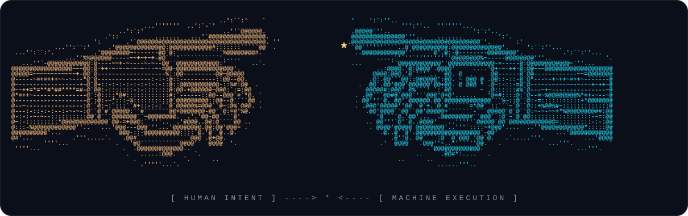
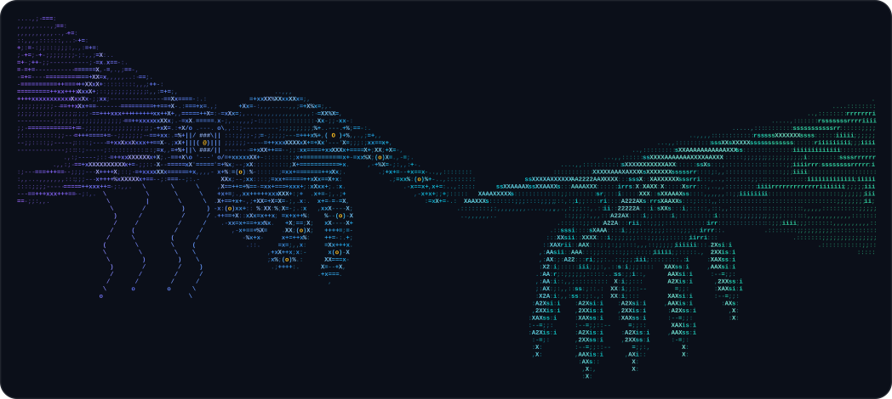
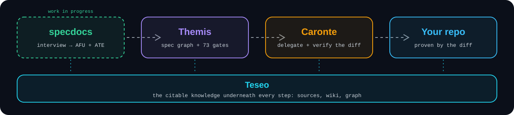

 

  

 

 

I build tools that make AI-assisted work verifiable: **orchestration you can audit, knowledge you can cite, and requirements an agent cannot ignore.**

## Featured projects

<table>
<tr>
<td width="50%"></td>
<td width="50%"></td>
</tr>
<tr>
<td width="50%"></td>
<td width="50%"></td>
</tr>
<tr>
<td width="50%"></td>
<td width="50%"></td>
</tr>
</table>

## How the pieces fit

Specdocs interviews people and writes the analysis. Themis turns it into a graph and enforces it on the coding agent. Caronte makes sure the agent's delivery is proven by the diff, and Teseo keeps the knowledge behind it citable. Radika and SaliceSocialBar are the products I build with the same method.

## Stack

<b>Full list</b>

**Languages:** TypeScript · Python · JavaScript (Node.js) · Rust · SQL · LaTeX

**Frontend:** React 19 · Vite · Tailwind CSS 4 · shadcn/ui and Radix · TanStack Query · Zustand · React Router · GSAP · Recharts

**Backend:** Fastify · Flask · Zod · Pydantic · jose (JWT/OIDC) · Pino

**Data:** PostgreSQL · Drizzle ORM · SQLite and FTS5 · Redis

**AI and agents:** Claude Code (hooks, subagents, skills) · Anthropic and OpenAI SDKs · Model Context Protocol · Codex · GitHub Copilot CLI · GLiNER, PyTorch and Transformers for NER

**Cloud and delivery:** Vercel · Supabase Auth · S3-compatible storage (Cloudflare R2, MinIO) · Stripe · GitHub Actions · Tauri 2 · Inno Setup · Nuitka

**Quality and security:** Vitest · Playwright · axe-core · pytest · ESLint · Prettier · ruff · mypy · CodeQL · TruffleHog

**Documents and standards:** Markdown · Tectonic and LaTeX · Mermaid · IEEE 1016 · ISO/IEC/IEEE 29148 · MADR · ReqIF · OpenProject · WCAG 2.2

## How I work

- Verification comes from deterministic checks, not from the agent's own report.
- Context lives in plain files and folders, so any agent or person can pick up where the work stopped.
- Specs, requirements and tests stay linked from the first interview to the last test.

 

**Let's talk** · [manuelalbanese.it](https://manuelalbanese.it) · [LinkedIn](https://www.linkedin.com/in/manuel-albanese/) · [Email](mailto:manuel.albanese.lavoro@gmail.com)

